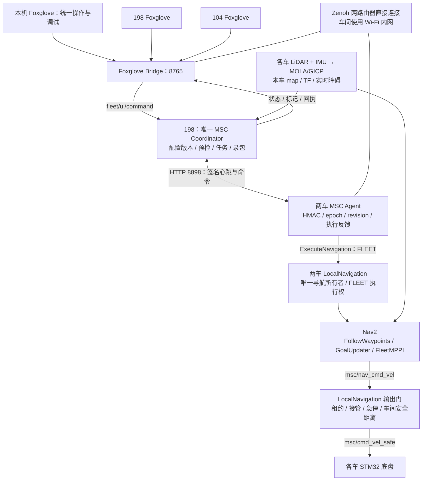
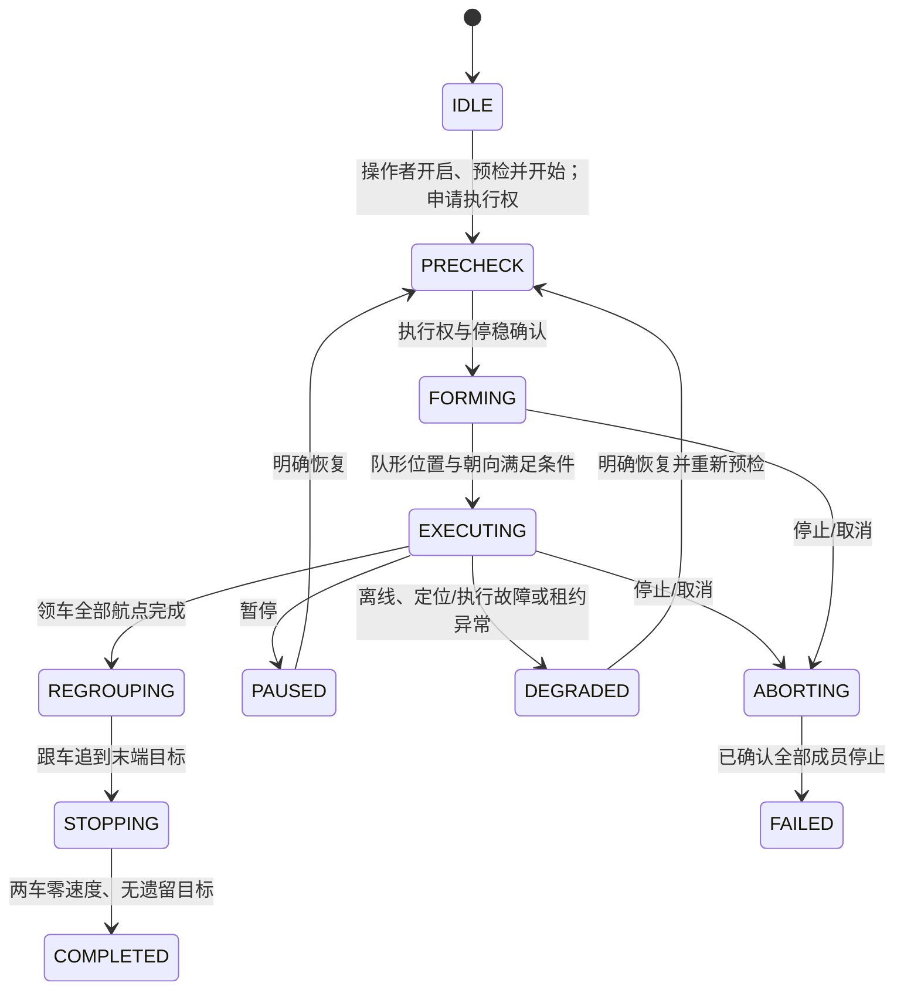

# 两车 Foxglove 总调度：工程设计与交付

本设计基于现有多机协同架构。Windows 电脑是统一操作端；10.0.0.198（robot_113）仍运行唯一 MSC Coordinator，10.0.0.104（robot_104）是执行节点。两台车的 Foxglove 和本机操作同一后端，共享配置版本、请求回执、任务状态和停止机制。没有增加第二个调度器。

## 架构与控制路径

电脑不直接发布底盘速度，也不绕过车端执行权。电脑断开时，车端仍负责执行已接受的任务；调度后端或执行租约失效时，车端输出门停止并取消任务。不要把“电脑断开”理解为“全部任务已取消”。

## 本次接入

| 层 | 实现 |
|---|---|
| 操作端 | 本机新增原生 fleet 视图；两车新增内置 OmniFleetDispatchPanel，保留既有语义导航面板 |
| 协议 | 沿用 `/fleet/ui/command`、`/fleet/ui/state`；新增解锁/锁定、全部预检、全部开始、全部停止 |
| 调度 | 198 唯一 Coordinator；任务 ID、epoch、revision 与重复请求控制继续生效 |
| 动态跟随 | 领车运行原生航点任务；跟车使用领车后方虚拟目标与 GoalUpdater，保留一个 FLEET 动作所有者 |
| 固定航点 | Agent 传递完整航点数组；原生 Waypoint Follower 的子动作经车端代理，共用父任务的 FLEET 执行权 |
| 控制器 | 专用 FleetMPPI：vx_max=0.025、vx_min=-0.025、wz_max=0.08；专用到点检查 xy=0.08 m、yaw=0.25 rad |
| 本车导航 | 继续使用原控制器与原到点参数；进度检查采用原生 PoseProgressChecker，保留 0.1 m / 10 s 并加入 0.1 rad 转向进度 |
| 输出门 | 所有速度仍经过 LocalNavigation；原生协同任务另按 FleetMPPI 的实际参数限制输出 |
| 坐标 | 同伴障碍图已按本车 map 栅格发布；Coordinator 在有效配准时发布非参考车地图 TF 链接 |
| 录包 | 点击开始任务后才启动轻量录包；任务结束并确认停稳后停止，没有新增常驻诊断采集 |

动态跟随采用“追踪领车后方目标”，转弯可能选择不同于领车走过的路径；它不等同于原有 trail 模式。

## 状态机

协同运动解锁是任务状态机之外的准入开关。重启默认锁定；“开启协同调度”只解锁，不发车。

独立固定航点任务采用既有任务状态：`PENDING → CLAIMED → RUNNING → FINISHING → COMPLETED`。取消进入 `CANCELING`；失联或执行失败进入 `RECOVERY_REQUIRED`，确认原执行者停稳后才能释放。两车同时开始要求路线安全通道不相交；本次没有新增通用交叉路权优化器。

## 使用

1. 本机布局已经选为“OmniFleet 两车总调度 · PC · Nav2”，连接 `ws://10.0.0.198:8765`。
2. 激活两辆车、选模式及领车；在共享地图发布位姿或逐行填写 `x, y, 朝向角度`，保存路线。
3. 点击“开启协同调度（不发车）”。然后点击“开始领航编队”，或固定航点模式的“开始全部固定路线”。开始操作自动进行最新预检并申请执行权。
4. “停止全部任务”可撤销正在预检的开始请求，也可取消已运行任务。以任务状态、两车零速度和无活动目标确认完成，不能只看请求回执。
5. 录包路径显示在面板中，数据保存到 198 的 `~/omnifleet_data/recordings/bags/fleet_ui_*`。

车端布局文件：两车均为 `~/omnifleet_ws/src/visualization/omnifleet_t2_ws/foxglove/fleet_panel/OmniFleet_总调度.json`；旧布局中的协同面板也已更新。新面板可从“添加面板”选择“两车总调度 · Nav2”。

## 验证与边界

- 已通过 38 项既有调度/地图/安全测试、7 项新增接入检查、3 项前端检查。
- 隔离 ROS 检查验证了唯一安全输出、手动优先、车间碰撞停止、过期执行租约、急停锁存，以及晚到动作接受的取消。
- 两车原生 Nav2 接口、专用控制器、配准和本机实时数据显示已核对；配置请求已收到真实后端回执，未发运动目标。
- 上一轮手动 Nav2 演示完成了短距离实车测试；本次接入后的完整 Foxglove → MSC → FLEET 执行链仍需实车验收，不能沿用上一轮测试当作本次闭环证明。
- 198 定位进程换代后，已重新采集静止点云配准：重叠约 79.7%，内点误差约 5.7 cm；这是扫描一致性，不能代替真实位置精度验收。
- Zenoh 车间链路改为 `192.168.3.104 → 192.168.3.113:7447`，控制/实时/交互队列从 2 增至 16，以处理已观察到的可靠消息队列拥塞关闭。没有新增网关。
- 两车源码、配置及 UI 回退文件位于 `/var/tmp/omnifleet_foxglove_backup_20261009`；本机原布局及应用资源备份在本目录。
